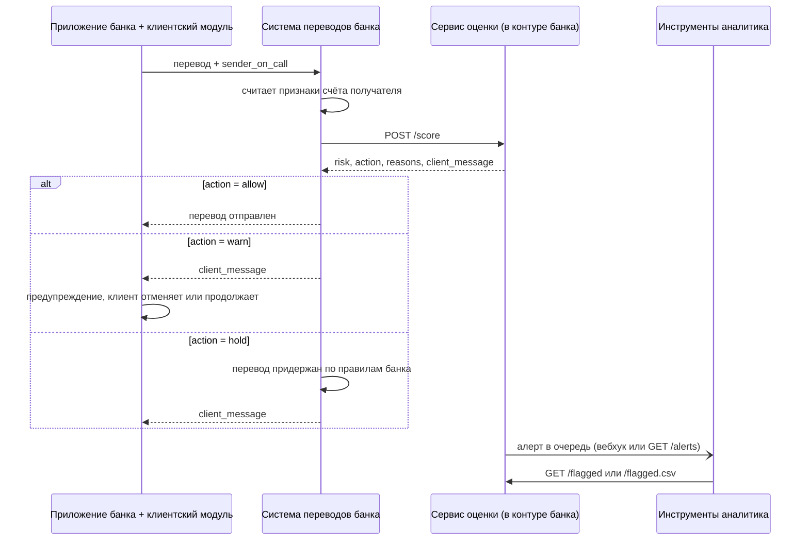

# Интеграция

Модуль — надстройка над системами банка. Переписывать их не нужно: банк добавляет один вызов
в обработку перевода, одно поле в запрос мобильного приложения и подключает выгрузку к своим
инструментам аналитика.

## Где модуль встаёт в поток перевода



Сервис даёт рекомендацию. Отправить, придержать или отклонить перевод решает система банка
по своим правилам.

## Что банк делает на своей стороне

| Точка | Что добавить | Где |
|---|---|---|
| Сервис оценки | Развернуть сервис в своём контуре; перед отправкой перевода вызвать `POST /score` и обработать `action` | Система переводов |
| Клиентский модуль | Передавать с переводом поля `sender_on_call` и `remote_access_active`; показывать `client_message` при `warn` и `hold` | Мобильное приложение |
| Алерты | Принимать алерты по вебхуку или забирать `GET /alerts`; показывать карточку инцидента дежурному | Система ведения инцидентов (Case Management) |
| Выгрузка | Забирать `GET /flagged` или `/flagged.csv` по расписанию | Антифрод, BI, SIEM, Excel |

## 1. Сервис оценки

### Что нужно на входе

Признаки счёта получателя банк считает сам по своим данным. Сервис не подключается к базам банка
и не хранит историю операций.

| Поле | Что это | Из чего считается |
|---|---|---|
| `account_id` | Псевдоним счёта (токен или хеш) | Любой устойчивый идентификатор, который банк может сопоставить со счётом |
| `account_age_days` | Возраст счёта в днях | Дата открытия счёта |
| `unrelated_senders_7d` | Число разных отправителей за 7 дней, у которых раньше не было переводов этому получателю | История входящих переводов |
| `fast_outflow_share_7d` | Доля поступлений за 7 дней, ушедшая со счёта в течение часа (0–1) | История зачислений и списаний |
| `shared_device_accounts` | В сколько других счетов входили с тех же устройств | Журнал входов с идентификатором устройства |

Дополнительные сигналы. Они необязательны: если банк их не передаёт, модель работает по четырём базовым признакам.

| Поле | Что это | Из чего считается |
|---|---|---|
| `idle_days_before_inflow` | Сколько дней подряд на счёте не было операций перед поступлениями последних 7 дней | История операций по счёту |
| `new_device_7d` | 1 — за 7 дней в счёт входили с нового для него устройства, 0 — нет | Журнал входов с идентификатором устройства |
| `flagged_linked_senders_7d` | Сколько незнакомых отправителей за 7 дней платили и на счета, которые банк уже заблокировал или пометил | История переводов и список заблокированных счетов |

Обстоятельства перевода:

| Поле | Что это |
|---|---|
| `amount` | Сумма перевода |
| `sender_on_call` | Клиент на звонке — приходит из клиентского модуля; `null`, если модуль не подключён |
| `remote_access_active` | На телефоне включён удалённый доступ к экрану — из клиентского модуля; `null`, если не проверялось |
| `first_transfer_to_recipient` | `true` — клиент раньше не переводил этому получателю, `false` — уже переводил, `null` — неизвестно |
| `amount_to_typical_ratio` | Сумма, делённая на обычный перевод клиента (например, медиану за 90 дней) |

Любой признак получателя можно не передавать: он не повлияет на оценку, а его имя вернётся
в `missing_features`. Так можно начать с тех признаков, которые у банка уже есть.

Персональные данные сервису не нужны: ни ИИН, ни ФИО, ни номер счёта, ни номер телефона.

### Что банк получает

| Поле | Что это |
|---|---|
| `risk` | Оценка риска получателя от 0 до 1 |
| `action` | `allow` — пропустить, `warn` — предупредить клиента, `hold` — придержать перевод |
| `reasons` | Причины: код и текст на языке `lang` (`ru`, `kk`, `en`) |
| `client_message` | Готовый текст предупреждения для клиента |
| `contributions` | Вклад каждого признака в оценку — для аналитика и разбора спорных случаев |

Полное описание — [openapi.yaml](openapi.yaml); работающий сервис отдаёт его по `GET /openapi.yaml`.

### Как принимается решение

Оценка получателя — градиентный бустинг LightGBM по четырём признакам счёта с ограничением
монотонности: риск не падает, когда счёт моложе, незнакомых отправителей больше, вывод быстрее или
общих устройств больше. Вклад каждого признака — значение Шепли (SHAP), вклады в сумме дают оценку,
поэтому видно, из чего она сложилась (подробнее — в [METRICS.md](METRICS.md) и
[MODEL_VALIDATION.md](MODEL_VALIDATION.md)). Деревья считает сам сервис, без Python. Обстоятельства перевода в модель не входят: они меняют рекомендацию по
явным правилам (`decide` в [service/src/model.ts](../service/src/model.ts)).

| Риск получателя | Обычный перевод | Клиент на звонке или включён удалённый доступ, и получатель новый |
|---|---|---|
| не ниже порога `hold` | придержать | придержать |
| не ниже порога `warn` | предупредить | придержать |
| не ниже порога `soft` | пропустить | предупредить |
| ниже `soft` | пропустить | предупредить, если включён удалённый доступ или сумма в 3 раза и более выше обычной; иначе пропустить |

Если банк сообщил, что клиент **уже переводил** этому получателю (`first_transfer_to_recipient: false`)
и удалённого доступа нет, решение по признакам счёта смягчается на ступень: придержать →
предупредить, предупредить → пропустить. Счёт, на который человек платит не в первый раз, ему не
продиктовали по телефону только что; на синтетических данных это правило сокращает число зря
побеспокоенных честных переводов с 22 до 8 на 1000 при росте пропущенных мошеннических с 4 до 5
на 100. Если поле не передано, смягчения нет.

Поверх таблицы действует память сервиса о счёте — она берётся из очереди алертов:

| Что сервис уже знает о счёте | Что меняется |
|---|---|
| Аналитик закрыл алерт по счёту как мошенничество | Любой перевод на счёт придерживается, причина `CONFIRMED_FRAUD` |
| Аналитик закрыл алерт как ложное срабатывание | Признаки счёта больше не тревожат; звонок и удалённый доступ продолжают действовать |
| За сутки ещё три клиента получили предупреждение или приостановку на этот счёт | Решение поднимается на ступень: пропустить → предупредить → придержать, причина `REPEAT_TARGET` |

Клиенты различаются по `client_ref`, поэтому для правила про нескольких клиентов банк должен его
передавать. Действует итог последнего закрытого алерта по счёту.

Повторный запрос с тем же `transfer_id` (например, после сбоя связи) получает ответ, но второй
алерт не создаёт.

Пороги лежат в [service/model/model.json](../service/model/model.json) в поле `thresholds`. Банк
меняет их под свою допустимую долю ложных срабатываний; что стоит каждый порог — в
[METRICS.md](METRICS.md).

### Развёртывание

- Один процесс Node.js (проверено на версии 24) без базы данных и без выхода в интернет. Запуск: `npm run service`.
- Для показа стенд и сервис можно разместить вместе на Vercel: `npm run build` на Vercel кладёт сервис
  серверной функцией на `/api/*` ([scripts/hosted-output.mjs](../scripts/hosted-output.mjs)). Список помеченных
  счетов там живёт, пока жив экземпляр функции, и может обнулиться.
- Настройки через переменные окружения:

| Переменная | Значение по умолчанию | Назначение |
|---|---|---|
| `PORT` | `8787` | Порт |
| `HOST` | `127.0.0.1` | Адрес, на котором слушает сервис |
| `SCORE_API_KEY` | не задан | Если задан, запросы должны нести заголовок `X-API-Key` |
| `ALERT_WEBHOOK_URL` | не задан | Адрес системы ведения инцидентов банка: каждый новый алерт уходит туда запросом POST |
| `DATA_FILE` | `service/data/flagged.json` | Файл со списком помеченных счетов |
| `SHADOW` | выключен | `SHADOW=1` — теневой режим для пилота (см. раздел 5) |
| `DEMO` | включён | `DEMO=0` отключает `DELETE /flagged` (очистка списка для стенда) и восстановление алертов по копии со стенда |

- Если сервис недоступен или не ответил за отведённое время, банк проводит перевод по своим
  обычным правилам. Модуль не должен становиться точкой отказа переводов.

### Что нужно сделать перед боевым использованием

- **Пройти пилот в теневом режиме** (раздел 5) и выбрать пороги по его итогам.
- **Переобучить модель на данных банка.** Сейчас модель обучена на синтетических данных. Нужен
  CSV-файл со счетами, теми же четырьмя признаками и отметкой «дроппер / не дроппер»:
  `npm run train -- --data счета.csv` (формат — в [METRICS.md](METRICS.md)).
- **Заменить хранилище помеченных счетов.** Сейчас это один JSON-файл; для нескольких экземпляров
  сервиса нужна общая база или очередь банка.
- **Закрыть доступ средствами банка.** `X-API-Key` — простая защита; в контуре банка обычно
  используют mTLS или шлюз API.
- **Убрать `DELETE /flagged`**: запускать с `DEMO=0`.

## 2. Клиентский модуль

Модуль отдаёт два признака — «клиент на звонке» и «телефоном могут управлять удалённо» — и показывает предупреждение.
В сеть он не ходит и ничего не хранит.

| Платформа | Файл | Что внутри |
|---|---|---|
| Android | [sdk/android/CallSignal.kt](../sdk/android/CallSignal.kt) | `CallSignal.isOnCall(context)` и слежение за началом звонка |
| Android | [sdk/android/RemoteAccessSignal.kt](../sdk/android/RemoteAccessSignal.kt) | `RemoteAccessSignal.check(context)` и слежение за записью экрана |
| Android | [sdk/android/TransferWarning.kt](../sdk/android/TransferWarning.kt) | Показ предупреждения стандартным диалогом |
| iOS | [sdk/ios/CallSignal.swift](../sdk/ios/CallSignal.swift) | `CallSignal.isOnCall()` |
| Веб, WebView | [sdk/web/dropper-guard.ts](../sdk/web/dropper-guard.ts) | `callSignal()`, `remoteAccessSignal()` и `showWarning()`; работает на стенде |

Встраивание в приложение:

1. На экране подтверждения перевода вызвать `CallSignal.isOnCall(...)` и `RemoteAccessSignal.check(...)`
   и добавить результаты в существующий запрос перевода полями `sender_on_call` и `remote_access_active`.
2. Если в ответе пришли `action` = `warn` или `hold` и `client_message` — показать его
   (`TransferWarning.show(...)` или свой компонент банка).
3. При `warn` клиент выбирает: отменить перевод или продолжить. При `hold` перевод не уходит.

Код для Android проверен тестовым приложением [sdk/android-test](../sdk/android-test/README.md)
на одном телефоне: Samsung SM-S928B, Android 14. Без единого разрешения приложение увидело начало
разговора (режим `IN_COMMUNICATION`) и его конец. Обычный звонок (режим `IN_CALL`) проверен только
на эмуляторе Android 17: приложение увидело его и по опросу, и через слушатель. На настоящих
телефонах обычный звонок, другие мессенджеры и другие устройства не проверялись — это нужно
сделать на парке устройств банка. Код для iOS написан по документации и не собирался. Веб-модуль проверен на стенде.

### Сигнал звонка на Android: можно ли без разрешений

Да. `AudioManager.getMode()` доступен с первой версии Android и не требует разрешений.

| Способ | Разрешение | Что видит |
|---|---|---|
| `AudioManager.getMode()` | не нужно | Обычный звонок (`MODE_IN_CALL`) и звонок в мессенджере (`MODE_IN_COMMUNICATION`) |
| `AudioManager.addOnModeChangedListener()` | не нужно, Android 12+ | То же, с уведомлением о начале и конце звонка |
| `TelephonyManager.getCallState()`, `TelephonyCallback.CallStateListener` | `READ_PHONE_STATE` для приложений с targetSdk 31+ | Только звонки по сотовой сети |

Мы используем `AudioManager`: разрешение не нужно, а звонки в мессенджерах, через которые
мошенники часто и работают, тоже видны. `TelephonyManager` их не показывает и требует
разрешения «Телефон», которое клиент выдаёт в диалоге системы.

Ограничения способа:

- Режим `MODE_IN_COMMUNICATION` выставляет само приложение связи. Мессенджер, который этого не
  делает, виден не будет. Какие мессенджеры на каких устройствах видны — нужно проверить на парке
  устройств банка.
- Сигнал говорит только «идёт разговор»: ни номера, ни собеседника, ни длительности.
- Поведение на прошивках разных производителей документацией не гарантировано.

Если сигнал окажется ненадёжным, замены такие:

1. Попросить у клиента разрешение `READ_PHONE_STATE` и использовать `TelephonyCallback` как
   дополнение — только для звонков по сотовой сети.
2. Получать факт звонка от оператора связи, если у банка есть такое соглашение.
3. Работать без сигнала: сервис принимает `sender_on_call: null` и оценивает перевод по
   признакам получателя. Сколько при этом теряется — в [METRICS.md](METRICS.md).

### Удалённый доступ к телефону (AnyDesk и подобные)

Вторая распространённая схема: мошенник просит установить программу удалённого доступа и сам
ведёт перевод с экрана клиента. [RemoteAccessSignal.kt](../sdk/android/RemoteAccessSignal.kt)
делает три проверки; ни одна не показывает клиенту диалог разрешения.

| Проверка | Что означает | Сила признака |
|---|---|---|
| Включена служба специальных возможностей известной программы удалённого доступа | Программа может нажимать на экран за человека | Сильный — идёт в `remote_access_active` |
| Экран приложения записывается или транслируется (Android 15+) | Кто-то видит экран банка | Сильный, но только на новых версиях |
| Известная программа установлена | AnyDesk, RustDesk, TeamViewer QuickSupport, TeamViewer Host, AirDroid | Слабый — программа может стоять по работе |

В манифест приложения добавляются блок `<queries>` и строка `DETECT_SCREEN_RECORDING` (выдаётся
при установке) — образец в
[sdk/android-test/app/src/main/AndroidManifest.xml](../sdk/android-test/app/src/main/AndroidManifest.xml).

Ограничения:

- Код собирается, но на телефоне с включённой программой удалённого доступа **не проверялся**.
- Список программ ведёт банк: названия пакетов меняются, появляются новые программы и сборки под
  своим именем. Имена пакетов AnyDesk и RustDesk сверены с их страницами; остальные взяты по памяти
  и требуют сверки с магазином приложений.
- Программа, которая только показывает экран и не использует службу специальных возможностей,
  на Android 14 и ниже видна лишь как «установлена».
- В расчёт метрик признак не входит: данных о доле таких переводов нет.

На iOS `CXCallObserver` (CallKit) разрешений не требует и видит звонки приложений, работающих
через CallKit.

Источники: [AudioManager](https://developer.android.com/reference/android/media/AudioManager),
[TelephonyManager](https://developer.android.com/reference/android/telephony/TelephonyManager),
[TelephonyCallback.CallStateListener](https://developer.android.com/reference/android/telephony/TelephonyCallback.CallStateListener).

## 3. Алерты для антифрод-аналитика

Когда сервис рекомендует `warn` или `hold`, он в тот же момент создаёт алерт. Отдельной панели
у модуля нет: алерт попадает в систему ведения инцидентов (Case Management), которая у банка уже
есть, и она показывает карточку дежурному сотруднику фрод-мониторинга.

| Способ доставки | Как работает |
|---|---|
| Вебхук | Сервис запущен с `ALERT_WEBHOOK_URL` — новый алерт сразу уходит на этот адрес запросом POST. Ответ клиенту от доставки не зависит; при сбое алерт остаётся в очереди |
| Опрос | Система банка забирает `GET /alerts?status=new` по расписанию |

Что в алерте:

| Поле | Что это |
|---|---|
| `priority` | `high` — перевод придержан или на телефоне включён удалённый доступ; иначе `medium` |
| `triggers` | Сработавшие триггеры: код и текст, те же, что в ответе `POST /score` |
| `signals` | Что сообщил телефон клиента: был ли он на звонке, включён ли удалённый доступ, новый ли получатель |
| `amount`, `action`, `risk` | Сумма перевода, рекомендация и оценка |
| `client_ref` | Псевдоним клиента из запроса `POST /score` |
| `account_id`, `transfer_id` | Псевдоним счёта получателя и идентификатор перевода |
| `status`, `resolution` | Состояние разбора и его итог |

**Контакты клиента.** Сервис оценки не получает ни ФИО, ни телефона. Банк передаёт в
`POST /score` псевдоним клиента `client_ref`, он возвращается в алерте, и система ведения
инцидентов сама подставляет контакты из своей базы. Так карточка инцидента показывает контакты,
а персональные данные не выходят за пределы систем, где они уже лежат.

Аналитик меняет состояние алерта через `PATCH /alerts/{alert_id}`: `in_progress` — взял в работу,
`closed` с `resolution` `fraud` или `legit` — закрыл. Итог разбора — готовая разметка для
переобучения модели на данных банка.

На стенде очередь и карточку показывает демонстрационная панель дежурного: алерты в ней настоящие,
из очереди сервиса, а контакты клиентов вымышлены.

Ограничения: очередь хранится в одном JSON-файле (последние 2000 алертов); повторной доставки по
вебхуку нет — недоставленный алерт забирается опросом.

## 4. Выгрузка для аналитика

Счёт попадает в выгрузку, когда сервис рекомендовал `warn` или `hold`. Отдельного интерфейса нет:
данные забирают имеющиеся инструменты банка.

| Способ | Запрос |
|---|---|
| JSON по API | `GET /flagged` |
| CSV-файл | `GET /flagged.csv` |
| CSV для Excel с русскими настройками | `GET /flagged.csv?separator=semicolon` |

Фильтры: `since` (ISO 8601), `min_risk` (0–1), `action` (`warn` или `hold`). Пример:

```
curl "http://127.0.0.1:8787/flagged.csv?min_risk=0.9&action=hold&since=2026-11-01T00:00:00Z" -o flagged.csv
```

На каждый счёт одна строка: максимальный риск, последняя рекомендация, число и сумма помеченных
переводов, время первой и последней пометки, причины (коды и текст), значения признаков, версия модели.

## 5. Пилот в теневом режиме

Первый шаг внедрения — 1–2 месяца, в течение которых модуль работает параллельно и ничего не
блокирует. Банк сравнивает его ответы с подтверждёнными случаями мошенничества и только потом
выбирает пороги и включает рекомендации.

### Как это работает

1. Сервис запускается с `SHADOW=1`. На каждый `POST /score` он отвечает `action: "allow"` и
   `client_message: null`, поэтому интеграционный код банка не задерживает переводы и не показывает
   клиентам предупреждений. Вебхук в систему инцидентов не отправляется.
2. Настоящая рекомендация приходит в поле `recommended_action`, оценка — в `risk`. Банк сохраняет
   `transfer_id`, `risk`, `recommended_action` и сумму перевода у себя в журнале.
3. Алерты всё равно копятся в `GET /alerts` — аналитики могут выборочно смотреть их, не беря в
   работу.
4. В конце периода банк выгружает из своего реестра переводы, которые признаны мошенническими, и
   запускает отчёт:

```
npm run shadow-report -- --responses ответы.csv --confirmed подтверждённые.csv --days 30
```

Отчёт показывает, сколько подтверждённых мошеннических переводов сервис заметил бы и на какую
сумму, сколько честных переводов он побеспокоил бы зря на 10 000 и сколько срабатываний в день
пришлось бы разбирать. Таблица порогов по оценке счёта показывает, чем банк платит за каждый
вариант. Посмотреть, как выглядит отчёт, без данных банка: `npm run shadow-report -- --example`.

5. Выбранные пороги банк вписывает в `service/model/model.json` (поле `thresholds`), проверяет их
   калькулятором выгоды ([BUSINESS_CASE.md](BUSINESS_CASE.md)) и перезапускает сервис без `SHADOW`.

Подтверждённые случаи из пилота — это ещё и разметка: по ней модель переобучается на данных банка
(`npm run train -- --data счета.csv`).

### Какие данные нужны банку

| Данные | Зачем | Скорее всего уже есть |
|---|---|---|
| Дата открытия счёта получателя | Признак `account_age_days` | Да — в АБС |
| История входящих переводов на счёт получателя | Признак `unrelated_senders_7d`: незнакомые отправители за 7 дней | Да — в процессинге |
| Время зачислений и списаний | Признак `fast_outflow_share_7d`: доля денег, ушедших за час | Да — в процессинге |
| Журнал входов с идентификатором устройства | Признак `shared_device_accounts`: общие устройства; сигнал `new_device_7d`: новое устройство | Вероятно — в системе антифрода или журналах мобильного приложения |
| История операций по счёту получателя | Сигнал `idle_days_before_inflow`: сколько счёт молчал перед поступлениями | Да — в АБС |
| Список заблокированных и помеченных счетов | Сигнал `flagged_linked_senders_7d`: отправители, которые платили и на такие счета | Да — в антифрод-подразделении |
| Переводил ли клиент этому получателю раньше и его обычная сумма | Поля `first_transfer_to_recipient`, `amount_to_typical_ratio` | Да — история переводов клиента |
| Сигналы телефона: звонок, удалённый доступ | Поля `sender_on_call`, `remote_access_active` | Нет — появятся после встраивания клиентского модуля; до этого пилот идёт без них |
| Реестр подтверждённых мошеннических переводов с `transfer_id` | Сравнение в конце пилота | Да — обращения клиентов, решения антифрод-подразделения |
| Журнал ответов сервиса | Сравнение в конце пилота | Нет — банк начинает сохранять его с первого дня пилота |

Пилот можно начать и без сигналов телефона: признаки счёта и истории переводов у банка есть.
Отчёт покажет, сколько даёт одна оценка счёта, а сигналы телефона добавятся вторым этапом.

### Чего пилот не покажет

- Сколько клиентов отменили бы перевод после предупреждения: в теневом режиме предупреждений нет.
  Это измеряют после включения, сравнивая отменённые переводы с предупреждёнными.
- Мошеннические переводы, о которых банк так и не узнал, в реестр не попадут, поэтому доля
  замеченных будет оценкой сверху.

## 6. Расследование сети (Network Investigation)

Дополнительный аналитический инструмент для сотрудника антифрода. Он не заменяет основной
антифрод и не принимает решений: основной антифрод находит подозрительную операцию, а модуль
показывает всю сеть связей вокруг неё — кто ещё переводил на этот счёт, куда ушли деньги, с каких
устройств и номеров входили участники, есть ли связь с делами, которые банк уже закрыл как
мошенничество.

### Как подключается

1. Основной антифрод передаёт в модуль номер своего сигнала, счёт, клиента или перевод:
   `POST /graph/investigate` с `alert_id`, `entity_id` или `transfer_id`. Алерты сервиса оценки
   из раздела 3 попадают туда сами.
2. Модуль читает данные, которые у банка уже есть, через интерфейс `BankGraphSource`
   ([service/src/graph/types.ts](../service/src/graph/types.ts)). В банке его реализует адаптер к
   хранилищу банка; на стенде — демонстрационный набор
   ([service/src/graph/demo-source.ts](../service/src/graph/demo-source.ts)), передаётся в
   `createApp({ graph })`.
3. Модуль строит граф, оценивает роль каждого счёта и возвращает находки с объяснением, источником
   и уверенностью. Сотрудник смотрит их на вкладке «Network Investigation» или в своей системе
   ведения инцидентов.

Что модуль не делает: не обрабатывает платежи, не авторизует клиентов, не блокирует счета и не
меняет решения основного антифрода.

| Что нужно от банка (`BankGraphSource`) | Откуда берётся |
|---|---|
| `entity`, `search` — клиенты, счета (дата открытия, период простоя), карты | Справочники клиентов и счетов |
| `links` — устройства, IP-адреса, номера телефонов, с какого по какое время | Журнал входов в мобильный банк, справочник клиентов |
| `transfers`, `transfer` — переводы счёта: сумма, время, канал | Платёжные данные |
| `marks`, `confirmedFraud` — решения по делам и алерты | Система ведения инцидентов, основной антифрод |
| `incoming` — что передано на расследование | Очередь основного антифрода |

### Что считает модуль

| Находка | Правило |
|---|---|
| Транзитный счёт | За период ушло не меньше 80% поступившего, и не меньше 60% поступлений ушло в течение двух часов. Роль «признаки дропа» — только если к этому добавляются другие признаки: свежий или долго молчавший счёт, общее устройство или номер с другими подозрительными счетами, связь с подтверждённым делом, алерты антифрода |
| Сборщик | Получает деньги от двух и более транзитных счетов и отправляет их дальше |
| Вероятно пострадавший | Старый счёт без признаков транзита, перевод на транзитный счёт; уверенность выше, если во время перевода клиент был на звонке или телефоном управляли удалённо |
| Много отправителей, не транзит | Пять и более отправителей, но деньги остаются на счёте — продавец, сбор денег |
| Общий идентификатор | Устройство, номер телефона или IP-адрес у двух и более клиентов; без других признаков — низкая уверенность (семейный планшет, домашняя сеть) |
| Повторяющаяся схема | Деньги двух и более разных людей проходят через транзитные счета к одному получателю в течение трёх часов |
| Путь до подтверждённого дела | Кратчайший путь по переводам, устройствам и телефонам. IP-адрес — слабая связь; путь через людей без признаков схемы штрафуется и помечается как слабый |
| Центральный узел | Посредничество (betweenness) внутри построенного графа, только среди счетов с признаками схемы |
| Денежный маршрут | Цепочка переводов, где каждый следующий — в течение суток после предыдущего |

Уверенность модуля не поднимается выше 0,9. Уверенность 0,95 бывает только у решений банка по делам.
Узлы с очень большим числом связей (общественный Wi-Fi, сеть оператора, крупный продавец) граф
показывает, но не раскрывает дальше и не прокладывает через них путь.

### Ограничения

- Правила и пороги подобраны вручную на демонстрационных данных, на реальных случаях банка не
  проверялись. Перед боевым использованием их нужно сверить с закрытыми делами.
- Модуль видит переводы только внутри банка и выход из него: что происходит в другом банке или на
  бирже, граф не покажет.
- Демонстрационный набор хранится в памяти; адаптер к хранилищу банка нужно написать под его схему.

## 7. «Треугольник» в P2P

Схема: мошенник выставляет на OLX или в Telegram дешёвый товар и одновременно покупает криптовалюту
у честного продавца на P2P-площадке. Покупателю товара он даёт реквизиты продавца криптовалюты.
Покупатель платит «за товар», продавец видит деньги и отпускает криптовалюту мошеннику. Покупатель
остаётся без товара, продавцу блокируют карту как дропу, а мошенника в банковском переводе нет.

Банк не видит ни объявления, ни переписки, ни биржи. Поэтому модуль не пытается найти мошенника по
переводам, а срывает сделку в двух местах, где банк может вмешаться, и не наказывает продавца.

### 1. У отправителя: назначение платежа

Приложение банка спрашивает «за что платите». Банк передаёт ответ в `POST /score`
(`context.payment_purpose`) и флаг `recipient.p2p_trader_profile` — получатель по данным банка
продаёт криптовалюту на P2P (много разовых плательщиков с назначением «криптовалюта», деньги уходят на
биржу). Оплата товара или услуги новому такому получателю — причина `TRIANGLE` и предупреждение:
«сверьте имя получателя с продавцом из объявления». Счёт продавца честный, и оценка счёта его не
поднимает — работает отдельное правило.

### 2. У получателя: `POST /incoming`

Главный рычаг: предупредить продавца криптовалюты до того, как он отпустит её мошеннику. Банк
получателя вызывает `POST /incoming` при поступлении на счёт своего клиента:

| Ситуация | Ответ |
|---|---|
| Перевод из другого банка, банк отправителя сообщил о мошенничестве через Антифрод-центр Национального банка | `hold_credit`: зачисление придержано, продавцу — «не отдавайте криптовалюту за этот платёж» |
| Назначение «товар или услуга», получатель продаёт криптовалюту | `notify`: деньги зачислены, продавцу — «сверьте имя отправителя с покупателем на площадке» |
| Обычная покупка криптовалюты | `none` |

Для BCC это особенно важно: обманутый покупатель часто платит из другого банка, и BCC узнаёт о проблеме
как банк получателя. Антифрод-центр Национального банка с 2024 года передаёт такие отметки между
банками; правила его работы утверждены постановлением Правления Национального банка от 25 августа 2025
года. Модуль принимает отметку как входной сигнал (`antifraud_center`); подключение к самому центру
делает банк.

### 3. В расследовании сети

Продавец криптовалюты, которому платили «за товар», получает роль `p2p_intermediary`, а не «признаки
дропа». Те, кто платил ему «за товар», — вероятно пострадавшие. Находка «Похоже на треугольник»
советует:

1. не блокировать счёт продавца — скорее всего, он тоже пострадал;
2. запросить у него ордера P2P-площадки за даты этих платежей: ник и реквизиты покупателя на бирже —
   единственная ниточка к мошеннику;
3. вернуть деньги пострадавшим через Антифрод-центр.

### Ограничения

- Без назначения платежа правило не работает: банк должен спрашивать клиента и хранить ответ.
- Флаг `p2p_trader_profile` банк считает сам; модуль не определяет, кто продаёт криптовалюту.
- Мошенника по данным банка не найти: он остаётся за пределами банковских переводов.
- Правила и тексты проверены только на демонстрационных данных; казахские тексты нужно вычитать.
