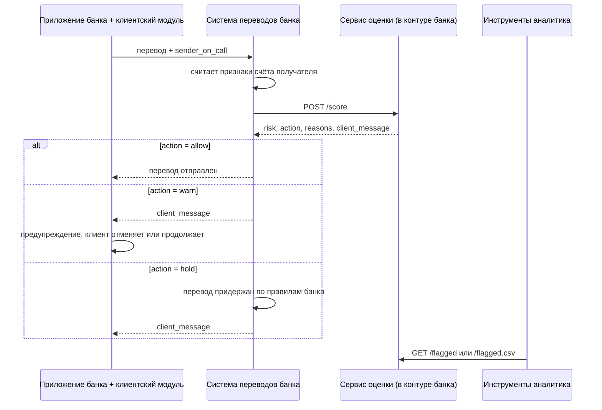

# Интеграция

Модуль — надстройка над системами банка. Переписывать их не нужно: банк добавляет один вызов
в обработку перевода, одно поле в запрос мобильного приложения и подключает выгрузку к своим
инструментам аналитика.

## Где модуль встаёт в поток перевода



Сервис даёт рекомендацию. Отправить, придержать или отклонить перевод решает система банка
по своим правилам.

## Что банк делает на своей стороне

| Точка | Что добавить | Где |
|---|---|---|
| Сервис оценки | Развернуть сервис в своём контуре; перед отправкой перевода вызвать `POST /score` и обработать `action` | Система переводов |
| Клиентский модуль | Передавать с переводом поле `sender_on_call`; показывать `client_message` при `warn` и `hold` | Мобильное приложение |
| Выгрузка | Забирать `GET /flagged` или `/flagged.csv` по расписанию | Антифрод, BI, SIEM, Excel |

## 1. Сервис оценки

### Что нужно на входе

Признаки счёта получателя банк считает сам по своим данным. Сервис не подключается к базам банка
и не хранит историю операций.

| Поле | Что это | Из чего считается |
|---|---|---|
| `account_id` | Псевдоним счёта (токен или хеш) | Любой устойчивый идентификатор, который банк может сопоставить со счётом |
| `account_age_days` | Возраст счёта в днях | Дата открытия счёта |
| `unrelated_senders_7d` | Число разных отправителей за 7 дней, у которых раньше не было переводов этому получателю | История входящих переводов |
| `fast_outflow_share_7d` | Доля поступлений за 7 дней, ушедшая со счёта в течение часа (0–1) | История зачислений и списаний |
| `shared_device_accounts` | В сколько других счетов входили с тех же устройств | Журнал входов с идентификатором устройства |

Обстоятельства перевода:

| Поле | Что это |
|---|---|
| `amount` | Сумма перевода |
| `sender_on_call` | Клиент на звонке — приходит из клиентского модуля; `null`, если модуль не подключён |
| `first_transfer_to_recipient` | Клиент раньше не переводил этому получателю |
| `amount_to_typical_ratio` | Сумма, делённая на обычный перевод клиента (например, медиану за 90 дней) |

Любой признак получателя можно не передавать: он не повлияет на оценку, а его имя вернётся
в `missing_features`. Так можно начать с тех признаков, которые у банка уже есть.

Персональные данные сервису не нужны: ни ИИН, ни ФИО, ни номер счёта, ни номер телефона.

### Что банк получает

| Поле | Что это |
|---|---|
| `risk` | Оценка риска получателя от 0 до 1 |
| `action` | `allow` — пропустить, `warn` — предупредить клиента, `hold` — придержать перевод |
| `reasons` | Причины: код и текст на языке `lang` (`ru`, `kk`, `en`) |
| `client_message` | Готовый текст предупреждения для клиента |
| `contributions` | Вклад каждого признака в оценку — для аналитика и разбора спорных случаев |

Полное описание — [openapi.yaml](openapi.yaml); работающий сервис отдаёт его по `GET /openapi.yaml`.

### Как принимается решение

Оценка получателя — логистическая регрессия по четырём признакам счёта. У каждого признака один
вес, поэтому видно, из чего сложилась оценка. Обстоятельства перевода в модель не входят: они
меняют рекомендацию по явным правилам (`decide` в [service/src/model.ts](../service/src/model.ts)).

| Риск получателя | Обычный перевод | Клиент на звонке и переводит этому получателю впервые |
|---|---|---|
| не ниже порога `hold` | придержать | придержать |
| не ниже порога `warn` | предупредить | придержать |
| не ниже порога `soft` | пропустить | предупредить |
| ниже `soft` | пропустить | предупредить, если сумма в 3 раза и более выше обычной; иначе пропустить |

Пороги лежат в [service/model/model.json](../service/model/model.json) в поле `thresholds`. Банк
меняет их под свою допустимую долю ложных срабатываний; что стоит каждый порог — в
[METRICS.md](METRICS.md).

### Развёртывание

- Один процесс Node.js (проверено на версии 24) без базы данных и без выхода в интернет. Запуск: `npm run service`.
- Настройки через переменные окружения:

| Переменная | Значение по умолчанию | Назначение |
|---|---|---|
| `PORT` | `8787` | Порт |
| `HOST` | `127.0.0.1` | Адрес, на котором слушает сервис |
| `SCORE_API_KEY` | не задан | Если задан, запросы должны нести заголовок `X-API-Key` |
| `DATA_FILE` | `service/data/flagged.json` | Файл со списком помеченных счетов |
| `DEMO` | включён | `DEMO=0` отключает `DELETE /flagged` (очистка списка для стенда) |

- Если сервис недоступен или не ответил за отведённое время, банк проводит перевод по своим
  обычным правилам. Модуль не должен становиться точкой отказа переводов.

### Что нужно сделать перед боевым использованием

- **Переобучить модель на данных банка.** Сейчас веса получены на синтетических данных
  (`npm run train`). Нужна выборка счетов с теми же четырьмя признаками и отметкой «дроппер / не дроппер».
- **Заменить хранилище помеченных счетов.** Сейчас это один JSON-файл; для нескольких экземпляров
  сервиса нужна общая база или очередь банка.
- **Закрыть доступ средствами банка.** `X-API-Key` — простая защита; в контуре банка обычно
  используют mTLS или шлюз API.
- **Убрать `DELETE /flagged`**: запускать с `DEMO=0`.

## 2. Клиентский модуль

Модуль делает две вещи: отдаёт признак «клиент на звонке» и показывает предупреждение.
В сеть он не ходит и ничего не хранит.

| Платформа | Файл | Что внутри |
|---|---|---|
| Android | [sdk/android/CallSignal.kt](../sdk/android/CallSignal.kt) | `CallSignal.isOnCall(context)` и слежение за началом звонка |
| Android | [sdk/android/TransferWarning.kt](../sdk/android/TransferWarning.kt) | Показ предупреждения стандартным диалогом |
| iOS | [sdk/ios/CallSignal.swift](../sdk/ios/CallSignal.swift) | `CallSignal.isOnCall()` |
| Веб, WebView | [sdk/web/dropper-guard.ts](../sdk/web/dropper-guard.ts) | `callSignal()` и `showWarning()`; работает на стенде |

Встраивание в приложение:

1. На экране подтверждения перевода вызвать `CallSignal.isOnCall(...)` и добавить результат
   в существующий запрос перевода полем `sender_on_call`.
2. Если в ответе пришли `action` = `warn` или `hold` и `client_message` — показать его
   (`TransferWarning.show(...)` или свой компонент банка).
3. При `warn` клиент выбирает: отменить перевод или продолжить. При `hold` перевод не уходит.

Код для Android проверен тестовым приложением [sdk/android-test](../sdk/android-test/README.md)
на одном телефоне: Samsung SM-S928B, Android 14. Без единого разрешения приложение увидело начало
разговора (режим `IN_COMMUNICATION`) и его конец. Обычный звонок по сотовой сети (режим `IN_CALL`),
другие мессенджеры и другие устройства не проверялись — это нужно сделать на парке устройств
банка. Код для iOS написан по документации и не собирался. Веб-модуль проверен на стенде.

### Сигнал звонка на Android: можно ли без разрешений

Да. `AudioManager.getMode()` доступен с первой версии Android и не требует разрешений.

| Способ | Разрешение | Что видит |
|---|---|---|
| `AudioManager.getMode()` | не нужно | Обычный звонок (`MODE_IN_CALL`) и звонок в мессенджере (`MODE_IN_COMMUNICATION`) |
| `AudioManager.addOnModeChangedListener()` | не нужно, Android 12+ | То же, с уведомлением о начале и конце звонка |
| `TelephonyManager.getCallState()`, `TelephonyCallback.CallStateListener` | `READ_PHONE_STATE` для приложений с targetSdk 31+ | Только звонки по сотовой сети |

Мы используем `AudioManager`: разрешение не нужно, а звонки в мессенджерах, через которые
мошенники часто и работают, тоже видны. `TelephonyManager` их не показывает и требует
разрешения «Телефон», которое клиент выдаёт в диалоге системы.

Ограничения способа:

- Режим `MODE_IN_COMMUNICATION` выставляет само приложение связи. Мессенджер, который этого не
  делает, виден не будет. Какие мессенджеры на каких устройствах видны — нужно проверить на парке
  устройств банка.
- Сигнал говорит только «идёт разговор»: ни номера, ни собеседника, ни длительности.
- Поведение на прошивках разных производителей документацией не гарантировано.

Если сигнал окажется ненадёжным, замены такие:

1. Попросить у клиента разрешение `READ_PHONE_STATE` и использовать `TelephonyCallback` как
   дополнение — только для звонков по сотовой сети.
2. Получать факт звонка от оператора связи, если у банка есть такое соглашение.
3. Работать без сигнала: сервис принимает `sender_on_call: null` и оценивает перевод по
   признакам получателя. Сколько при этом теряется — в [METRICS.md](METRICS.md).

На iOS `CXCallObserver` (CallKit) разрешений не требует и видит звонки приложений, работающих
через CallKit.

Источники: [AudioManager](https://developer.android.com/reference/android/media/AudioManager),
[TelephonyManager](https://developer.android.com/reference/android/telephony/TelephonyManager),
[TelephonyCallback.CallStateListener](https://developer.android.com/reference/android/telephony/TelephonyCallback.CallStateListener).

## 3. Выгрузка для аналитика

Счёт попадает в выгрузку, когда сервис рекомендовал `warn` или `hold`. Отдельного интерфейса нет:
данные забирают имеющиеся инструменты банка.

| Способ | Запрос |
|---|---|
| JSON по API | `GET /flagged` |
| CSV-файл | `GET /flagged.csv` |
| CSV для Excel с русскими настройками | `GET /flagged.csv?separator=semicolon` |

Фильтры: `since` (ISO 8601), `min_risk` (0–1), `action` (`warn` или `hold`). Пример:

```
curl "http://127.0.0.1:8787/flagged.csv?min_risk=0.9&action=hold&since=2026-11-01T00:00:00Z" -o flagged.csv
```

На каждый счёт одна строка: максимальный риск, последняя рекомендация, число и сумма помеченных
переводов, время первой и последней пометки, причины (коды и текст), значения признаков, версия модели.
